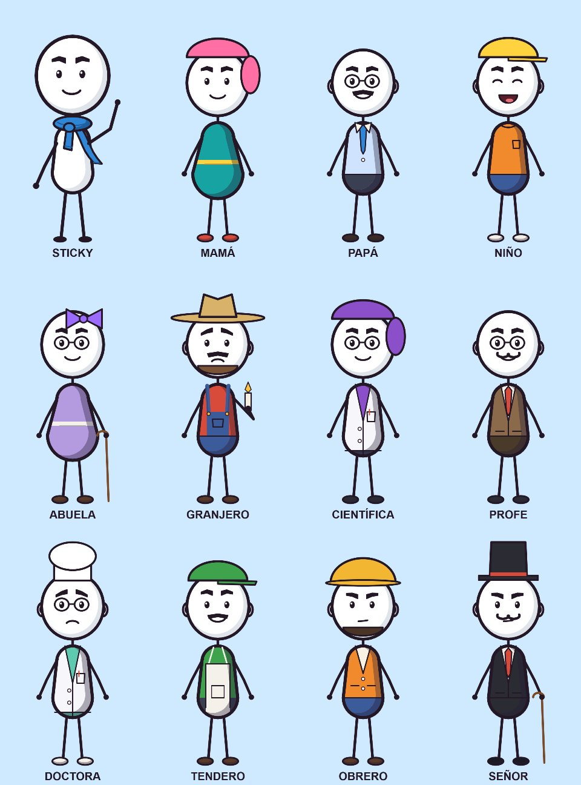
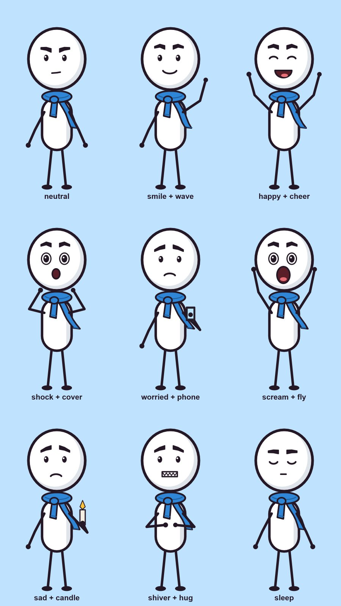
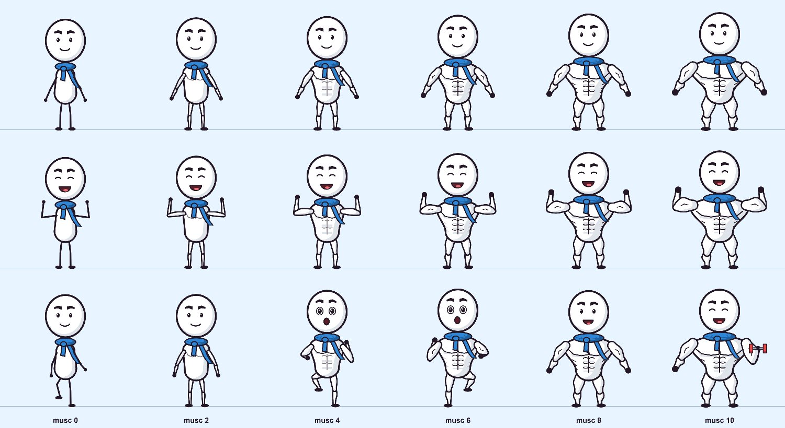
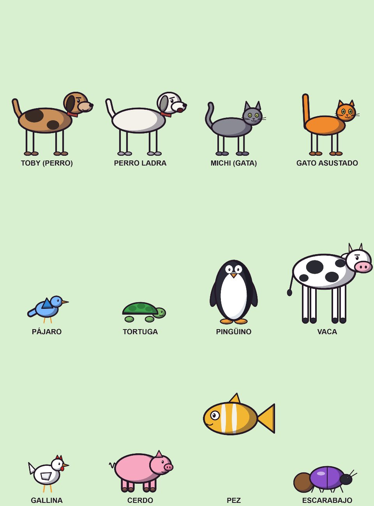
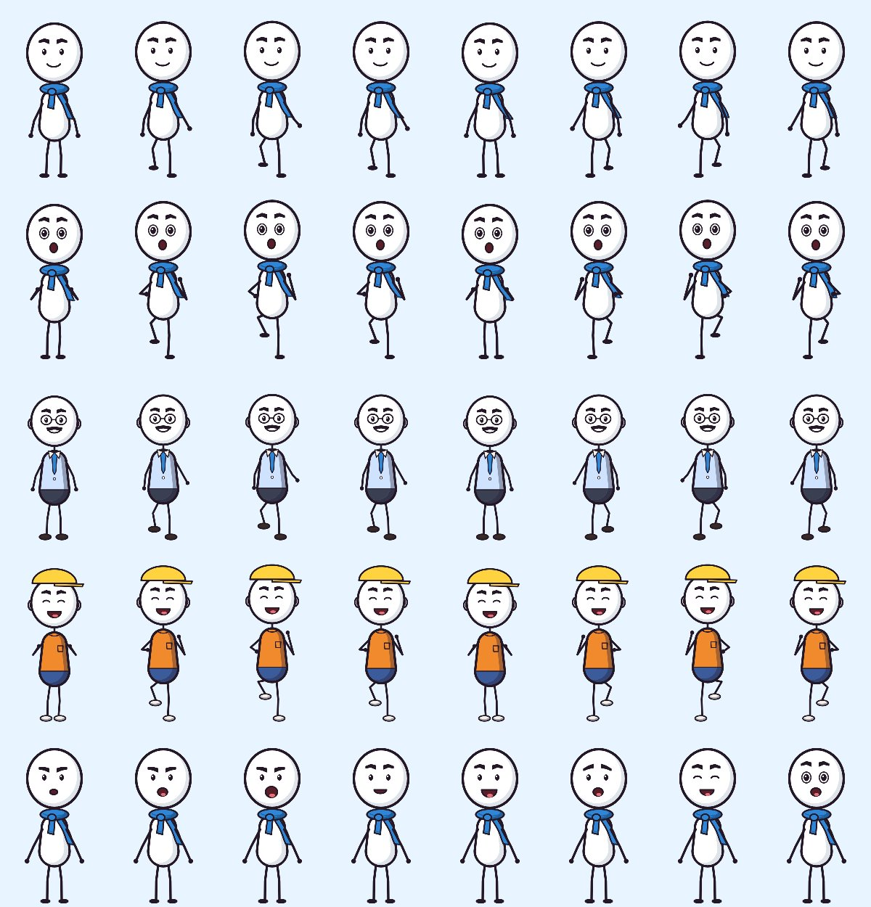

# Personajes de Curiosidades con Sticky

Todo el elenco fijo vive en el código, en **`shorts-sticky/src/engine/elenco.ts`**. Para que un personaje se vea igual en todos los videos, impórtalo desde ahí:

```ts
import { sticky, who, MAMA, PAPA, NINO, ABUELA, ESCALA } from "../engine/elenco";
```

No redefinas un personaje dentro de un video. Si necesitas uno nuevo, agrégalo en `elenco.ts` y apúntalo en esta tabla.



**Estilo v2 (nov 2026), igual para todos:** cabeza ovalada blanca con sombra gris, cejas gruesas expresivas y ojitos negros.
El torso tiene **forma de frijol, con ropa** (camisa, chaleco, overol, saco, bata, vestido o delantal), cuello, botones y bolsillos.
Todo lleva **sombra de corte duro** (cel-shading). Brazos y piernas son de palito, los zapatos de color, y hay orejas cuando no hay pelo largo.
En 3D cada personaje proyecta **su silueta como sombra en el piso**. Escena de muestra: `fotos/escena_v2.jpg`.

La ropa se elige en `PersonOpts`:
- `ropa`: `tee`, `shirt`, `vest`, `overall`, `jacket`, `coat`, `dress` o `apron`
- `shirt`, `pants` y `shoes`: colores de camisa, pantalón y zapatos
- `trim`: botones, cinta o solapa

Los extras reciben ropa al azar (pero fija) en `crowd.ts`. Para ver el elenco usa la composición `FichaElenco`:
`node scripts/fotos.mjs FichaElenco out/elenco_ 0 0.4`.

## Sticky, el protagonista



Diseño v2 (nov 2026), en el estilo de los personajes de los shorts de referencia, pero **todo blanco y con su bufanda azul**:

| Rasgo | Valor |
|---|---|
| Cabeza | Ovalada, blanca, grande, con sombra gris suave a la derecha y abajo |
| Cara | **Cejas negras gruesas** que dan la emoción, ojitos negros con brillo y boca expresiva |
| Cuerpo | Torso en **cápsula blanca** con contorno grueso; brazos y piernas de palito; zapatitos negros |
| Seña | **Bufanda azul `#2f86d6`** enrollada al cuello, con nudo, punta al frente y una cola que ondea (1.3 Hz, 8 pasos) |
| Escala | `ESCALA.sticky = 0.75` |
| Voz | El narrador (`es-MX-JorgeNeural`, +24 %) |
| Reglas | Sale en casi todas las escenas, siempre en primer plano, y **nunca hay nada entre la cámara y él** (`blocksLead`) |

El dibujo está en `sticky()` de `shorts-sticky/src/engine/stick.ts`. Para ver la ficha usa la composición `FichaSticky`:
`node scripts/fotos.mjs FichaSticky out/ficha_ 0 0.5`.

Expresiones (`expr`): `neutral smile lick shock sad scream happy worried shiver frozen relief sleep`.
Brazos (`arm`): `down icecream up cheer wave phone candle flash point fly hug cover flex curl`
(`flex` = saca bíceps con los dos brazos, `curl` = mancuerna roja en la mano derecha; también sirven para el elenco).

### Sticky musculoso (`musc`)



`musc` va de `0` (normal, el dibujo de siempre) a `10` (enorme). Con `elenco.ts`: `sticky(f, expr, arm, pos, look, walk, musc)`,
o en la tarjeta `o: { ..., musc: 8 }`. Al crecer:

- Torso en **V** (hombros redondos y anchos, cintura angosta), un poco más alto, con **pectorales, esternón, abdominales
  (2 filas desde musc 3, 3 filas desde musc 6) y oblicuos** en tinta, y sombra de corte duro bajo cada músculo.
- Brazos y piernas pasan de palito a **miembros blancos con contorno** y bíceps, antebrazo, muslo y pantorrilla.
  Los brazos que cuelgan se abren para no meterse en la espalda. Puños más grandes y zapatos más grandes.
- Cuello ancho (trapecios) y **bufanda azul estirada** con rayitas de tensión. **La cabeza no cambia de tamaño** (se ve chiquita a propósito).
- Caminar, correr, hablar y todas las poses siguen funcionando; los pies siguen en el piso (y = 964 del diseño).
- Con `musc > 0` la tarjeta es la **ancha `XBODY`** (1000 × 1000 de diseño, el dibujo corrido 200 a la derecha, mismos pies),
  así caben los brazos abiertos. `world.ts` lo hace solo.

Ficha: `node scripts/fotos.mjs FichaMusculo out/musc_ 0 0.25` (columnas musc 0, 2, 4, 6, 8, 10; filas parado, `flex` y camina/corre/habla/`curl`).

## Elenco fijo

| Constante | Quién | Cómo se ve | Dónde sale |
|---|---|---|---|
| `MAMA` (`MOM`) | Mamá | Coleta rosa, vestido turquesa con cinta amarilla | Casa, cocina |
| `PAPA` (`DAD`) | Papá | Bigote grueso, lentes, camisa celeste, corbata azul | Casa, ascensor |
| `NINO` (`KID`) | El niño | Gorra amarilla, playera naranja, jeans (escala `0.54`) | Casa, parque |
| `ABUELA` (`GRANNY`) | La abuela | Moño morado, lentes, bastón, vestido lila | Cocina |
| `GRANJERO` (`FARMER`) | El granjero | Sombrero de paja, bigote, barba, camisa roja con overol de mezclilla | Granja |
| `CIENTIFICA` | La científica | Coleta morada, lentes, bata blanca | Observatorio, aula |
| `PROFE` | El profe | Bigote rizado, lentes, saco café, corbata roja | Aula |
| `DOCTORA` | La doctora | Gorro blanco, lentes, bata blanca, uniforme verde agua | Hospital |
| `TENDERO` | El tendero | Gorra verde, bigote fino, delantal | Tienda |
| `OBRERO` | El obrero | Casco amarillo, barba, chaleco naranja | Calle |
| `SENOR` | El señor elegante | Sombrero de copa, bigote rizado, bastón, traje negro | Calle, parque |
| `TOBY` | El perro de la familia | Café con mancha oscura | Casa, parque |
| `MICHI` | La gata de la familia | Gris | Casa |

## Extras (gente de fondo)

Los extras salen de `extra(i, seed)` en `crowd.ts`. Con la misma semilla siempre sale la misma gente.

- **Mezcla:** 62 % adultos, 12 % niños, 12 % perros, 9 % gatos y 5 % pájaros.
- **Gorros:** gorra, sombrero de copa, bombín, gorro de lana, vaquero, moño, pelo parado, coleta, casco o gorro de chef.
- **Detalles:** 35 % de los adultos llevan bigote (grueso, rizado o fino). También hay barba, lentes, corbata, bolso y bastón.
- **Colocación:** usa `band({...})` para poner un grupo en un rectángulo. Esquiva solo el pasillo entre la cámara y Sticky.
- **Regla:** no todos salen en todas las escenas. Pon de 2 a 6 personajes por escena interior y una multitud solo en la calle o el parque.

## Animales y cosas que son tarjetas



Los animales también están en el estilo v2: cuerpo relleno con sombra de corte duro, manchas recortadas dentro del cuerpo,
ojitos negros con brillo, cejas expresivas y patas finas con patitas de color. Para ver la ficha usa la composición `FichaAnimales`:
`node scripts/fotos.mjs FichaAnimales out/animales_ 0 0.4`.

| `kind` | Qué es |
|---|---|
| `dog` `cat` `bird` | Mascotas y pájaros. `mood` puede ser `calm`, `scared`, `howl`, `sleep` o `bark` |
| `cow` `chicken` `pig` | Animales de granja |
| `turtle` `penguin` `fish` `beetle` | Playa, polo, arrecife y desierto |
| `car` | Coche (tarjeta ancha). Con `lights` lleva los faros encendidos |
| `plane` | Avión (tarjeta ancha) |
| `wave` | Ola gigante (tarjeta ancha) |
| `top` | Trompo girando (para explicar el bamboleo de la Tierra) |

## Movimiento



Las filas de la ficha son: Sticky camina, Sticky corre, Papá camina, el niño corre y las bocas al hablar.

- **Caminar:** pon `walk: gait(f, hz)` (fase 0..1, 16 dibujos por ciclo). La rodilla se dobla, el pie se levanta, el cuerpo sube y baja, y los brazos en `down` se balancean solos.
- **Correr:** agrega `run: true`. Los pasos son más altos, los brazos bombean con el codo a 90° y el rebote es mayor. Usa `gait(f, 2.4)` o más rápido.
- **Hablar:** si la historia tiene `voz: VOZ` (`import VOZ from "../../voz/<video>/palabras.json"`), **Sticky mueve la boca solo** con el narrador, una vez por sílaba. Para que otro personaje hable, pásale `talk: bocaAt(VOZ, f)` (0..3).
- **Respirar:** todos los personajes suben y bajan muy poquito, de forma automática.
- Para que los pies no resbalen, mueve al personaje a unos 1.3 m/s cuando camina (`hz ≈ 1.1`) y a unos 3.5 m/s cuando corre (`hz ≈ 2.4`).

Para ver la ficha usa la composición `FichaMovimiento`: `node scripts/fotos.mjs FichaMovimiento out/mov_ 0 0.25`.

## Agregar un personaje nuevo

1. Agrega la constante en `elenco.ts` con un comentario que diga cómo se ve.
2. Agrega su fila en la tabla de arriba.
3. Si necesita un dibujo nuevo (otro `kind`), créalo en `stick.ts` y después en `types.ts` y en el bucle de tarjetas de `world.ts`.
4. Revisa cómo queda con `node scripts/fotos.mjs <Comp> prueba <frames>` antes de renderizar.
5. Sube los cambios (ver [SINCRONIZAR.md](SINCRONIZAR.md)).
